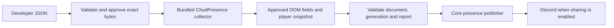

# ChudPresence Activity API V2

V2 is the public, declarative Activity API introduced in the Chromium lab 2.0.0.
Developers describe which media information to inspect. ChudPresence owns the
JavaScript that reads those fields, samples the player, and submits presence.
An installed V2 package contains no executable JavaScript.

[V1](https://github.com/ChudForks/ChudPresence-Activities/blob/main/ACTIVITY_API.md) remains available for trusted first-party integrations and
explicitly trusted local development. V2 does not expose V1's SDK or page bridge.

## Quick start

Create a folder with the following two files. Optionally include `icon.png` for
the Library card and declare `"icon": "icon.png"` in metadata.

`metadata.json`:

```json
{
  "id": "example-video",
  "name": "Example Video",
  "description": "Show media playback from Example Video.",
  "version": "1.0.0",
  "apiVersion": 2,
  "minExtensionVersion": "2.0.0",
  "matches": ["https://example.com/watch/*"],
  "excludeMatches": ["https://example.com/watch/private/*"],
  "entry": "activity.json"
}
```

`activity.json`:

```json
{
  "schemaVersion": 1,
  "kind": "video",
  "scope": "#player",
  "fields": {
    "title": {
      "source": "dom.text",
      "selectors": [".media-title", "h1"]
    },
    "creator": {
      "source": "dom.attribute",
      "selectors": [".media-creator"],
      "attribute": "title"
    }
  },
  "player": {
    "adapter": "html-media",
    "selectors": ["video", "audio"]
  }
}
```

Replace the example selectors with selectors for the actual website. The player
and metadata must be descendants of the same narrow approved container. All
values read from it may appear in Discord when sharing is enabled.

Open Activity Library, enable developer tools, select both JSON files, and click
**Load local Activity**. Review the hosts, container, fields, and player selectors.
**Approve installation** requests missing browser site permissions and approves
the exact staged bytes. Chrome 138+ requires **Allow User Scripts** in extension
details; earlier supported versions use Developer mode. This implementation uses
`chrome.userScripts` to run its bundled collector.

A ready-to-load example is in the lab's `examples/v2/html-media/` directory.

## Execution and data flow



Package contents are parsed with `JSON.parse` and embedded as serialized data
alongside bundled extension functions. They are never evaluated or interpolated
into a function body. There are no developer callbacks or returned DOM objects.

The collector sends a heartbeat every two seconds, resolving current elements and
checking route scope each time. It therefore handles DOM replacement and SPA
navigation. Missing titles (except the Prime Video retention described below),
missing/unready/ended players, excluded routes, and out-of-scope routes clear
existing reports. Background timer throttling can delay
sampling; this interval is not a timing guarantee.

Each report belongs to an enabled installation generation, top-frame document,
and tab. The worker checks current host permission and rejects stale generations.
Disable, uninstall, and revocation block publication. The collector removes its
timers on teardown/document exit. Startup and extension updates restore approved
stored configurations through the existing Activity Manager.

## Metadata

Required: `id`, `name`, `description`, `version`, `apiVersion`, `matches`, `entry`.
`apiVersion` must be `2`; `entry` must be `activity.json`.

| Field | Contract |
| --- | --- |
| `id` | 2–64 lowercase letters, digits or hyphens, starting with a letter or digit. |
| `name`, `description` | Non-empty text, at most 80 and 500 characters respectively. |
| `version`, `minExtensionVersion` | Semantic versions; minimum extension version is optional. |
| `matches` | 1–32 unique exact public HTTPS host patterns; paths may use `*`. |
| `excludeMatches` | Up to 32 patterns with the same restrictions. |
| `frames` | Omitted or `top`; child-frame execution is unavailable. |
| `icon` | Omitted or `icon.png`; validated PNG up to 256 KB. |

Optional discovery fields: `author`, `contributors`, `category`, `defaultMediaKind`,
`aliases`, `tags`, `repository`, `homepage`, `serviceUrl`, `settingsUi.statusLabels`.
Their bounds are in the metadata schema. Discovery URLs are static metadata, not
output destinations for extracted values. Author fields do not establish trust.

Unknown fields fail closed. `network`, `executionWorld`, custom `settings`,
`presence`, and capability declarations are not accepted. Wildcard hosts, IP
literals, local names, HTTP, ports in match patterns, Discord domains, and
extension/internal URLs are rejected. Host validation does not resolve DNS or
establish a general network firewall.

Chrome grants permissions for an entire origin. The collector and worker enforce
the narrower Activity path scope separately.

## Configuration and field rules

`schemaVersion` identifies the configuration format. It is separate from the
API's `apiVersion: 2` and the package's semantic version. Existing
`schemaVersion: 1` configurations retain the exact rules in this section, their
page mode, and fixed site adapters. The reusable media configuration below uses
`schemaVersion: 2`; its new properties are rejected on schema 1 configurations.

`kind`: `video`, `movie`, `episode`, `song`, `stream`, `game`, or `generic`.
Media configurations require a supported player. Generic page configurations
use the declarative page mode below and require no media player.

`scope`: a container selector containing an ID or class. The first visible,
permitted container among up to eight matches is selected. All field/player
queries operate inside that container.

`fields`: `title` is required. Optional text fields are `subtitle`, `artist`,
`album`, `series`, `creator`, `channel`, `category`, `game`, and `playlist`.
Numerical season/episode extraction is available only through the bundled
Prime Video details mode below.

| Rule option | Behavior |
| --- | --- |
| `source: "dom.text"` | Read bounded `textContent` only after the element and its descendants pass visibility checks. |
| `source: "dom.attribute"` | Read only `title`, `aria-label`, or `alt`. |
| `selectors` | One to four unique fallback selectors, tried in order. |
| `attribute` | Required for attribute reads; forbidden for text reads. |
| `removePrefix`, `removeSuffix` | Optional non-empty literal strings, at most 64 characters each. |

Whitespace is collapsed and trimmed automatically. Prefix/suffix removal is
literal, followed by trimming. Missing optional values are omitted. Missing title
means no presence. No regex, expression, callback, loop, or method name is accepted.

Selectors support tag, ID, and class compounds, with descendant/child combinators:
`.media-title`, `h1.title`, `#metadata > .creator span`. Attribute/pseudo selectors,
escapes, wildcards, sibling traversal, and comma lists are forbidden. Use the
fallback array. Limit: 256 characters and eight compound parts per selector.

Readable elements are headings, spans, paragraphs, divs, links, strong/bold,
emphasis/italic, small text, and images. Reads exclude root `html`/`body`, sensitive
elements/ancestors such as forms, inputs and editable content, hidden elements,
and subtrees containing sensitive nodes. Targets may have at most 16 descendants.
If any descendant fails the visibility checks (CSS `display: none`, hidden or
collapsed `visibility`, zero opacity, `content-visibility: hidden`, or no layout
rectangles), the entire field is skipped before reading its text or attribute.
Visible nested formatting is supported; use a narrower selector for markup that
mixes visible and hidden content. A rejected title clears presence, and a rejected
optional field is omitted.
Raw values over 1,024 characters are skipped; accepted values are capped at 256.
At most eight candidates per selector are considered.

## Reusable capabilities (schemaVersion 2)

Use `schemaVersion: 2` for sites whose public player and metadata can be described
with bounded selectors, transforms and playback rules. This format requires
extension 2.1.0 or later; declare `minExtensionVersion: "2.1.0"` in new packages.
Package changes to these
declarations require a package version increase and fresh installation review;
they do not require a new site adapter in the extension. The existing schema 1
packages keep their existing collector behavior and approvals.

The required configuration is `{schemaVersion, kind, scope, fields, player}`.
Optional `presentation` and `lookup` configure core formatting and a named trusted
service. `page`, custom player names, executable strings and extra properties are
rejected. `kind` accepts the same media kinds as schema 1. See
[the generic feed example](../examples/v2/generic-feed/) for a complete package.

Field names include the existing ten text fields plus `season` and `episode`.
`title` remains required. Text fields accept `dom.text`, `dom.attribute`, or
`constant`; the latter is exactly `{ "source": "constant", "value": "Video" }`.
Constant and fallback text must already be normalized, non-empty literal text
with no controls and at most 256 characters. Numeric constants/fallbacks must be
integers from 0 to 10,000. DOM season/episode rules require `parse: "integer"`.
DOM reads still accept only the `title`, `aria-label`, and `alt` attributes.

DOM rules accept the existing literal `removePrefix` and `removeSuffix` options,
plus `split: { "separator": " • ", "index": 1 }`. The literal separator has
1–64 characters; the selected part index is 0–15. These transformations run on
bounded normalized text, in prefix, suffix, split, then parse order. There are no
regular expressions or expressions. A `fallback` is used only when all selected
nodes are missing; present but hidden, sensitive, oversized or otherwise rejected
nodes cannot trigger it. Player retention also cannot preserve rejected fields.

Selectors additionally support quoted public attribute selection:
`[data-e2e="title"]`, `[role="button"]`, `[aria-label$=" Pause"]`, and
`[class*="DivDetails"]`. Permitted names are bounded `data-*` names, `role`,
`aria-label`, and `class` (also `dir` and `id` in extension 2.3.0); operators are `=`, `^=`, `$=`, and `*=`; quoted literals
have 1–128 characters and no escapes or controls. This selects nodes and does
not authorize reading the selected attribute. `href`, `value`, arbitrary
attributes, pseudos, wildcards, comma lists, sibling traversal and CSS escapes
are rejected. Limits remain 256 characters and eight selector parts. The scope
must contain a class, ID, or one of these public attributes. All existing
sensitive element, ancestor, descendant and visibility checks still apply.

Both player types require one to four `selectors`. Optional
`selection: "first" | "largest-visible"` chooses the first eligible player or
the player with the largest intersecting viewport area. Native media supplies
readiness, ended state, playback state and timing. DOM media must supply visible
canvas or loaded image evidence plus a permitted visible state control:

```json
{
  "adapter": "dom-media",
  "selectors": ["canvas", "img"],
  "state": {
    "selectors": ["[role=\"button\"]"],
    "attribute": "aria-label",
    "playing": ["Pause"],
    "paused": ["Play"]
  },
  "position": { "source": "dom.text", "selectors": [".position"], "parse": "clock" },
  "duration": { "source": "dom.text", "selectors": [".duration"], "parse": "number" }
}
```

`state` reads only `aria-label`; playing/paused arrays each have 1–4 unique
normalized literals up to 128 characters, with no overlap. Unknown labels clear
presence. Optional `position`/`duration` are DOM rules using `parse: "clock"` or
`"number"`, bounded to 0–31,536,000 seconds. They do not accept constant values or
fallbacks. `elapsed: true` instead enables session timing and cannot be combined
with DOM timing rules. `live` declares live playback. Both flags are booleans.

`retainMetadata: true` retains previously visible fields when controls disappear,
only for the same player, route and media source. On `html-media` only,
`allowAriaHidden: true` exempts the native media element's own accessibility
hiding; `canvasSelector` exempts only its own zero opacity when an overlapping
visible canvas supplies rendering evidence. Hidden ancestors and metadata are
still rejected. DOM media cannot enable either exception. HTML media cannot
provide DOM state or timing rules. None of these features inspects page scripts,
custom player objects, media URLs for publication, or arbitrary properties.

Optional `presentation` requires `details`, with optional `state` templates.
Templates contain literal text and `{field}` tokens for declared fields only;
the core renders and bounds them. `artwork` accepts static `large`, `largeText`,
`small`, and `smallText` properties, with `large` required. At most two static
`buttons` each contain a `label` up to 32 characters and a `url`. All image and
button destinations use exact public HTTPS URLs with no credentials, port,
query, fragment or template. Labels and artwork text are static normalized
literals. Extracted text can never become an image or button URL.

### Multiple layouts and public links (extension 2.2.0)

TikTok 1.1.0 uses these additional schema 2 capabilities instead of the bundled
TikTok adapter. Packages using them declare `minExtensionVersion: "2.2.0"`.
All declarations remain bounded JSON and appear in installation review.

- `paths` optionally limits a media configuration to 1–32 explicit paths. Whole
  segment tokens are `{number}` (1–25 digits), `{segment}` (1–256 ASCII slug
  characters), `{handle}` (`@` plus 1–64 ASCII username characters), and
  `{locale}` (two letters, optionally followed by a two-letter region). Tokens
  never cross a slash. Escapes, dot segments, wildcards, queries and fragments
  are not path syntax; query data is never read by these rules.
- `modes` supplies up to eight additional complete configurations, each with a
  unique `id`, `paths`, `kind`, `scope`, `fields` and `player`, plus optional
  presentation, links, lookup and binding rules. Modes do not inherit base
  fields or player options. Players from matching configurations compete by
  the base player's selection policy; smaller shared containers win remaining
  ties. A rejected selected player's metadata clears instead of borrowing
  another layout. Reports identify the chosen mode; the worker validates it
  against the current URL in that exact document.
- `container: { "ancestors": 5, "required": [".caption", ".creator"],
  "exclude": ["#app"] }` binds a scoped player to its nearest common metadata
  ancestor, within 1–5 parent steps. Searches stop at hidden/sensitive nodes,
  excluded selectors, or main/body/html roots. Only declared fields are read.
  Extension 2.3.0 adds `singlePlayer: true`: stop before an ancestor containing
  multiple approved players and permit up to sixteen parent steps. With this
  grant and `html-media`, `scope: "video"` or `"audio"` selects the native player
  itself, so deeply nested layouts need no site-specific class. The largest
  visible player's missing container clears instead of choosing a smaller neighbor.
- `requiredFields` names additional declared fields whose absence clears.
  Text rules can use `parse: "handle"` to normalize a public username to one
  `@` prefix. `candidateIndex: 1` selects the second candidate, bounded to 0–7.
  `ignoreEmptyBreaks: true` permits only childless BR formatting nodes in text;
  hidden spans, text-bearing nodes and sensitive descendants remain rejected.
  Extension 2.2.1 additionally supports `maxDescendants` from 1–128 on DOM
  fields, with the existing default of 16. TikTok 1.1.1 explicitly requests 64
  for its overlay caption because mentions/hashtags add public formatting nodes.
  Every descendant still passes visibility/sensitive checks before any text is
  read; raw and accepted text limits remain 1,024 and 256 characters. This
  explicit per-field grant requires fresh package review.
- `opacityAncestor: ".public-fade"` on a field or DOM link source exempts only
  that proper ancestor's zero opacity, inside the approved container. The
  field, its descendants, player, other ancestors and all other hiding checks
  remain enforced. This is a separate, explicit public fade-layer grant.
- `{ "source": "public-path", "selectors": [".creator a"],
  "paths": ["/{handle}"], "segment": 0 }` extracts one bounded path segment
  from an approved same-origin public anchor, without reading its query,
  fragment or text. `pageFallback: true` can instead use the matching current
  page path only when all targets are absent. Present rejected links block it.
  Extension 2.3.0 adds `matchText: true` to require visible anchor text matching
  the extracted segment, ignoring case and one leading @. Its text and every
  descendant pass the normal visibility checks; it cannot use `pageFallback`.
- `{ "source": "first", "rules": [ ... ] }` tries 1–4 non-nested DOM or
  public-path rules, stopping at the first present source. Rejected present
  content cannot fall through to another source, constant or hidden fallback.

`pageIdentity` declares `paths` and optional `fields`, mapping field names to
zero-based page path segment indices. `ignoreCase: true` explicitly permits
case-insensitive identity comparison. It can also bind a player's ID to a page
segment with `playerId` and `segment`. A player ID rule has a narrow `selector`,
literal `split` separator/index, and optional `prefixes` (1–4) and `parts`
(1–16). It reads only the selected player's own approved in-container ancestor's
`id`, producing 1–25 digits for identity or a link. It cannot publish arbitrary
attributes. This rejects overlay preloads for a different video.
Extension 2.3.0 also supports `links: { "media": 1 }` inside `pageIdentity`:
when the current page matches its paths, the declared link's segment at that
index must equal the page segment. The collector rejects conflicting matching
DOM links; the worker independently verifies the reported path against the
current document URL. Missing optional links remain optional.

Native `canvasContainer` narrows `canvasSelector` to the selected player's
matching in-container ancestor. An overlapping, visible, nonempty canvas in
that same renderer is required to exempt the source video's own zero opacity.

`links` defines up to two named public links. Each rule declares allowed `paths`,
optional `matchFields` bindings, and 1–4 ordered `sources`:

```json
{
  "media": {
    "paths": ["/{handle}/video/{number}"],
    "matchFields": { "channel": 0 },
    "sources": [
      { "source": "page" },
      { "source": "dom.link", "selectors": [".public-card a"] },
      { "source": "template", "path": "/{channel}/video/{id}",
        "playerId": { "selector": ".player", "split": { "separator": "-", "index": 2 }, "prefixes": ["video-player-"], "parts": 3 } }
    ]
  }
}
```

DOM link reads are restricted to permitted A elements in the same container and
exact page origin. Templates contain literal path segments, declared text-field
tokens and an explicitly parsed numeric `{id}`. They cannot contain an origin,
query, fragment, expression or arbitrary attribute. Reports carry only approved
relative paths; the worker checks patterns/bindings and reconstructs URLs using
the verified document origin. A presentation button uses
`{ "label": "View Video", "link": "media" }` instead of `url`. Unavailable links
omit their button. Extracted values cannot become an external destination or
artwork URL. `presentation.liveInDetails: true` suppresses the additional Live
marker when the approved details already describe LIVE playback.

## Named trusted service lookup

Schema 2 can declare `lookup: { "service": "movie-title", "input": {
"title": "title" } }`. The 2–64 character service identifier names an independently
trusted policy. The input map has 1–8 bounded parameter names, each referring to
a declared media field. It carries no URL, host, method, header, credentials,
expression, response parser, or output mapping. Discovery metadata cannot grant
network access.

The worker checks this declaration against the trusted service policy before any
request. The Activity's own approval determines its page scope; the service
policy determines the destination host and
path, explicit input bounds, request method, redirect handling, response limits,
cache behavior and returned presence fields. Unknown or unavailable services
fail closed. A package cannot create or change that policy, self-authorize a new
destination, obtain raw responses or initiate its own request. A permitted movie
service therefore cannot be changed into an arbitrary extraction destination by
editing activity JSON. Adding a new trusted service remains a separate trust
decision; ordinary selector and formatting changes stay in the package.

In Activity Library, enable Developer tools and use **Trusted lookup services**
to select a policy JSON, review its endpoint/inputs/output paths, enter its token
when required and approve its origins. Approve only policies from a source you
trust: public HTTPS syntax does not establish a destination's reputation. Policies
can be updated or revoked independently of Activity packages. The
[TMDB movie policy](../examples/v2/services/README.md) demonstrates the complete
workflow. Lookup inputs are sent to the service even when Discord sharing is off.
Unapproved/unavailable services leave base playback intact.

Schema 2 collector reports contain the exact configured `kind`, declared
`media` fields and bounded `playback`, plus an approved `modeId` and relative
`links` paths when declared. The worker verifies numeric fields and
constant values, validates declared service inputs and derives presentation and
service enrichment itself. Reports cannot supply URLs, presentation overrides,
service selectors or external destinations. User sharing and artwork/button preferences
remain enforced by core.

## Declarative page activity

A non-media activity uses `kind: "generic"` and `page` instead of `player`.
The same visible container and bounded DOM-field checks apply. No service
adapter is required. Google and Roblox are example packages.

`page.routes` contains one to thirty-two ordered routes with unique short `id`s,
bounded `paths`, a `query` map of explicit parameter names to literal allowed
values, `requiredQuery` names, a static `name`, `details`, and optional `state`.
Absent and empty mode parameters match the empty string; duplicate parameters
fail the route. Required query parameters must occur exactly once and be non-empty.
Paths use exact segments or whole `{number}` / `{segment}` tokens. `{number}`
matches 1–25 digits; `{segment}` matches 1–256 ASCII URL slug characters
(letters, digits, hyphens, underscores and percent escapes), excluding encoded
slash/backslash separators. Tokens never cross a slash or publish URL text.
For example, `/games/{number}/{segment}` matches an experience ID and slug;
declare separate paths for absent slugs and trailing slashes. Wildcards, regexes,
partial tokens and arbitrary expressions are unavailable. Installation hosts
still come exclusively from metadata matches and exclusions.

A route may declare `scope` to use another visible container, subject to the
same safe selector rules as the configuration scope. This supports a site's
distinct landing/detail layouts while keeping heading reads inside the detail
panel. A route may also declare a normalized static `title`, which replaces
and skips the configured title extraction on that route. The worker verifies
the exact literal title; missing visible containers still clear activity.
Roblox uses static titles on its browsing routes and the visible experience
heading on its detail route. The installation review lists both overrides.

Page fields may additionally use
`{ "source": "url.query", "parameter": "q" }`. This reads only that explicitly
named submitted URL parameter, collapses whitespace and applies the existing
1,024-character raw / 256-character accepted limits. Duplicate query values are
not read. Inputs, textareas, editable fields, drafts and arbitrary attributes
remain unavailable. Missing title clears activity unless the matched route
declares its static title. URL-query rules are rejected
in media-player configurations.

Names are static per route. Details/state templates support literal text and
`{field}` tokens for declared text fields only. If an optional state field is
missing or hidden, the entire state line is omitted. The worker verifies the
route and URL-query report against the sending document's URL and derives the
name and presentation from the approved configuration. Reports cannot override
names, templates, artwork or destinations.

Chromium may retain a user-script world's initial `sender.url` after same-document
navigation. For page reports, the worker reads the current URL with bundled code
targeted to the exact sender document ID and Activity world, verifies that ID and
the current grant, then validates routes/query fields against that URL. A missing
or replaced document fails closed. No package URL field or unrelated tab URL is
accepted as evidence; the document URL never becomes a report field.

`page.elapsed` is an explicit boolean. When true, core shows elapsed visible
session time without a Live label or a fabricated media duration. Query or mode
changes, path/route changes, hidden tabs and route exits reset the session.
Tracking parameters and fragments do not reset it. Page activities report
only while `document.visibilityState` is visible and resample on visibility
changes. Background audio/video behavior is unchanged.
Approved same-origin page navigation uses a bounded handoff: the outgoing
document hints at the destination; the worker verifies both route declarations,
host matches and exclusions before retaining the last valid report for up to five
seconds during document replacement. The new report cancels that hold. Closing
the browser tab, switching away or tearing down the Activity cancels it.
Navigation/readiness events request a coalesced sample after 100 ms; normal DOM
churn keeps the usual heartbeat cadence. Same-document navigation can retain
the last report while the approved replacement root briefly rebuilds.
Unsupported or external destinations do not receive a handoff. Discord update
intervals and rate limits still apply; mode changes use the same session token.

Optional `page.artwork` accepts static `large`, `largeText`, `small` and
`smallText`. Image URLs must be public HTTPS, with no credentials, ports,
queries, fragments or template tokens. Extracted text can never enter an image
URL. Core honors normal status/artwork/timer preferences. The installation
review shows routes, query reads, templates, artwork destinations and timer
behavior and explains that submitted search text may be shared with Discord.

## Player adapter

`player` accepts `adapter: "html-media"` and one to four fallback `selectors`.
The first visible, permitted, ready audio/video descendant provides:

- `state`: `playing` or `paused`; ended playback clears presence.
- `position`, `duration`: seconds, bounded to one year. Unknown/infinite duration becomes zero.
- `live`: true when duration is infinite.
- `rate`: playback rate bounded to 0–16.

The `html-media` adapter does not read media resource URLs or arbitrary site
JavaScript objects/methods.
The bundled `prime-video` adapter supports Prime's modern overlay player on
`primevideo.com` / `www.primevideo.com` and Amazon US `/gp/video/` pages. It
requires `kind: "video"`, `scope: ".dv-player-fullscreen"`, and player selectors
`[".atvwebplayersdk-video-surface video"]`. Its only fields are `title` from
`.atvwebplayersdk-title-text` and optional `subtitle` from
`.atvwebplayersdk-episode-info`, both `dom.text` with no transforms. Other
containers, fields or selectors are rejected for this adapter.

Prime marks its visible video `aria-hidden`; only that video's own accessibility
marker is exempted. Hidden ancestors and sensitive text remain excluded. When
Prime removes the controls, the adapter retains already-read visible metadata
for the same container, player, source, duration and route. Present but rejected
metadata never uses this fallback. A rejected title clears the retained metadata;
a rejected subtitle is omitted from both the current report and its retained copy.
End/load/empty events and identity changes
invalidate retention. Source URLs are compared only locally for invalidation and
are never report values or request destinations. Installing mid-playback may
require showing the controls once so the title can be sampled.

Prime Video may additionally declare `player.metadata: "prime-video-details"`.
This opt-in mode parses the player episode line into an episode name, series,
season and episode (numbers bounded to 0–10000). Episode reports use `kind:
"episode"`; core shows the clean episode title first and the series second.
Season/episode numbers remain in media metadata and artwork hover text. Reports
without a recognized episode keep their configured video kind.

Details mode also inspects fixed public title headings, episode headings,
play-link labels and images under `#main`. Artwork requires the detail-page
series to match the player. Episode thumbnails also require matching episode
name and play-link season/episode numbers; matching show art is the fallback.
Only HTTPS `/images/S/pv-target-images/` image paths on `m.media-amazon.com`
and Amazon's `images-na`, `images-eu` or `images-fe.ssl-images-amazon.com`
hosts are accepted, with no credentials, ports, queries or fragments. Images
and headings must pass visibility/sensitive-ancestor checks. No detail-page
requests, arbitrary destinations or package parsing expressions are supported.
Approval describes these additional reads and outputs; older packages do not
enable them automatically.

TikTok 1.1.0 uses the reusable schema 2 modes above. The compatibility
`tiktok` adapter preserves the fixed configuration approved by TikTok 1.0.x
packages. Its scope is `#main-content`; bundled selection also supports public
feed cards, `#main-content-video` and TikTok detail/LIVE player containers.
Its fixed `data-e2e` and public player class selectors are an adapter-specific
exception to the general selector subset. Packages cannot change those fields,
selectors, transforms, container or player declarations.

Only TikTok's For You, Following, individual video and LIVE routes are eligible.
An individual video opened from Explore/profile/search may use the public browse
overlay. Its player ID must match the video URL. The collector finds the nearest
container with the fixed public description, nickname and username within five
ancestor steps, never selecting app/body roots or reading comments. Grid previews
and unrelated browsing routes remain ineligible.
The collector chooses the video with the largest on-screen area, preferring
playing videos on ties. Metadata comes from that video's public card or player
container. Hidden/sensitive text, absent titles/creators, off-screen, unready and
ended videos clear reports. It builds public video/profile links from bounded
creator handles and video IDs, discarding tracking queries. Unknown video IDs
produce only the profile button. Messages, settings, uploads and other browsing
routes never produce presence.

TikTok video details show the description, state shows `Creator name (@username)`
and timestamps show video progress. LIVE details show `Watching Live`,
state shows the creator name and timestamps show the current viewing session's
elapsed time. The session resets when changing stream/player or leaving playback.
Core adds a flat square TikTok mobile icon from TikTok's Google Play artwork;
video thumbnails, posters and creator avatars are never inspected or published.
Core derives the formatting and honors artwork, button and progress preferences.
Current cards may render through a visible `tt-vod-sr-wrap` canvas while their
source VIDEO has zero opacity. Only that VIDEO's own opacity is exempted, only
with an overlapping visible sibling canvas inside the same TikTok player.
Hidden ancestors, absent/hidden canvases and hidden non-empty text still fail.
Empty description formatting leaves such as BR contribute no readable text.

TikTok 1.0.3's updated fixed declaration additionally supports current LIVE.
A `live-room-content` video's own panel must have a visible
`live-header-container` with `room-header-anchor-name` and its public profile
link. That link must match an individual LIVE URL. Public titles are used when
present in media metadata; when absent, the collector uses the static media-title
fallback `TikTok LIVE`. Core always displays `Watching Live` above the creator.
A present but
hidden/rejected title still clears. Chat and recommendations lie outside this
panel and are not read.

The featured `discover-list-live-card` reads its fixed `.e1xspjl31` title,
`.e1xspjl34` creator and public stream links. Only the zero opacity of that
card's known `.ee35qag0` public metadata fade layer is exempted, because TikTok
fades it during continuing playback. The video/card must remain visible;
display/visibility/accessibility hiding, hidden fields/descendants, sensitive
elements and other zero-opacity ancestors still reject reads. Older approved
1.0.0–1.0.2 configurations remain valid without these added reads; installing
the new exact declaration requires normal review and approval.

Instagram 1.1.0 uses the reusable schema 2 rules above for **reels only** and
requires extension 2.3.0. Stories are deferred. Its new package JSON owns all
selectors, card boundaries, creator matching, links and presentation. Existing
Instagram 1.0.0 approvals remain compatible, including video/photo stories.

The compatibility `instagram` adapter uses the fixed declaration in the old Instagram
V2 package: `kind: "video"`, `scope: ".x5lhr3w"`, and media selectors
`["video", "img"]`. The scope names the current Reels card; bundled selection
also handles bounded article and story panels. Its fixed attribute selectors
are an adapter-specific exception; changing fields, transforms or selectors is
rejected.

Only `/reels/`, individual `/reel/<id>/` / `/reels/<id>/`, and
`/stories/<username>/<id>/` routes are eligible. Reels choose the largest
visible ready video, then the playing video on ties. The nearest single-video
ancestor with the public creator anchor is considered within sixteen steps;
article layouts use their creator header. Captions come only from that card's
caption block or heading. A missing caption uses `Watching Reel`; a present
but rejected caption clears. Stories require a visible Play/Pause control, its
matching creator header, and loaded media within nine ancestor steps. Neighbor
previews, comments, replies, private routes and unrelated browsing are excluded.

Instagram reports have `kind: "video"`, creator/channel text, and the derived
`subtitle: "Reel" | "Story"`. Stories use `Watching Story`. Video media uses
native progress; photo stories use the visible control state with zero
position/duration and no fabricated timer. Core formats the title above
@username and adds only the static Instagram app logo. The two approved buttons
are View Reel or View Story and View Profile, rebuilt from bounded public
Instagram paths without queries/fragments. Unknown reel IDs produce only
View Profile. Reports cannot supply artwork, display overrides, arbitrary URLs
or private media fields. The adapter does not read image descriptions, media
URLs, page JavaScript or account data. See the lab-root
[V2 adapter report](../V2_ADAPTER_REPORT.md) for current API limits and possible
reusable future capabilities.

Schema 1 keeps these fixed bundled adapters. Schema 2 supports the reusable
players and templates described above. Cross-frame players, custom page objects,
ad detection and unrestricted dynamic destinations are unavailable. There is no
package function or code string escape hatch.

## Publication and privacy boundary

The bundled collector uses only `presence.report` and `presence.clear`. Reports
contain the approved `kind`, declared `media` text fields, and bounded `playback`.
Page reports additionally carry an approved `routeId`; core derives their
static artwork and presentation as described above. Unknown media fields,
`display`, buttons, and URL-bearing report fields are rejected
except for the fixed adapter outputs described here. TikTok permits at most two
fixed-label buttons to the reported creator's public video, LIVE or profile URL;
its reports cannot supply artwork or display overrides. Core sets the logo.
The Prime Video details mode additionally permits derived series/season/episode
fields and `artwork.large`/`largeText` with the fixed Amazon URL restrictions
above. The core derives formatting and applies user sharing/preferences.

V2 offers no package JavaScript, direct requests, page execution, Activity storage API,
cross-Activity reads, OAuth access, or browser API access. The USER_SCRIPT world's
`connect-src 'none'` is additional defense; the execution boundary is that all
executed code is bundled ChudPresence code. Named service requests are made only
by the worker under independently trusted policy, never by page-side packages.

This controls execution and outbound destinations. It cannot automatically prove
that author-selected text is public media metadata. A selector could identify
private text on an approved page. Review the exact declarations and approve only
media-related reads. Schema validation alone does not establish their meaning.

## Approval, updates and recovery

Every installation/update requires the Library review dialog. The approval digest
includes normalized metadata, available raw metadata bytes, configuration bytes,
icon, source type, and repository provenance. Changed bytes invalidate approval.
Installed configuration/metadata/icon hashes are checked before registration and
on restoration. Changed packages require a higher semantic version and fresh
approval; changing only build metadata is not a version increase.

V2 cannot replace V1 with the same ID, and V1 cannot replace V2. V2 cannot reuse
an ID from a different source type or repository. Uninstall first or use a new
ID. Local packages are user-selected files, not authenticated publisher identities.
V2 updates preserve user preferences and a disabled Activity's disabled state.
Local V1 loading requires the separate **Run trusted V1 JavaScript** action.

Declining approval leaves the current version untouched. Registration/storage
failure attempts to restore the previous approved version. Startup reconciliation
uses persisted installed records. This is the existing recovery model, not a new
transaction journal or a guarantee of atomic browser execution switching.

## Developer tooling and distribution

From the separate `ChudPresence-Activities-V2` checkout:

```sh
node tools/chudpresence.mjs activity new my-player
node tools/chudpresence.mjs activity validate my-player
node tools/chudpresence.mjs activity build my-player
```

`new` creates a V2 JSON package by default. V1 authoring remains in the separate
`ChudPresence-Activities` repository. V2 `build` validates JSON
and refreshes catalog hashes; it emits no JavaScript. V2 packages cannot contain
`activity.js`. Edit JSON, increase the version, select the files again, and approve
the update. JSON packages require no watch compilation.
Authors may add their own fixture tests under `tests/`.

Editor/TypeScript support: `schemas/activity-v2-metadata.schema.json`,
`schemas/activity-v2.schema.json`, and `@chudpresence/activity-sdk-v2/types`.
Types describe configuration, not runtime functions. Runtime validators enforce
extra restrictions beyond JSON Schema; validate through the CLI before publishing.
Use editor schema associations; `$schema` is not an accepted package field.

Canonical contract/validator: the Activities checkout's `schemas/activity-api-v2.json`
and `schemas/activity-api-v2.js`. Run `node tools/generate-api-v2.mjs` to regenerate
schemas, declarations, and lab copies. Metadata and configuration are each limited
to 64 KB; normalized reports retain the existing 16 KB limit.

The official `ChudForks/ChudPresence-Activities-V2` catalog distributes V2 JSON
packages through immutable revision downloads and SHA-256 verification. Discover
combines this catalog with the separate V1 catalog while preserving repository
provenance. Custom repository onboarding is not implemented; third-party authors
can load locally or submit to the V2 repository.

Keep this a fixed extraction format. Arbitrary expressions, code strings, loops,
or custom method dispatch would require another security/policy assessment.
Chrome restricts remote complex-command interpreters: [MV3 requirements](https://developer.chrome.com/docs/webstore/program-policies/mv3-requirements).
